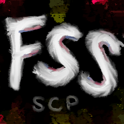
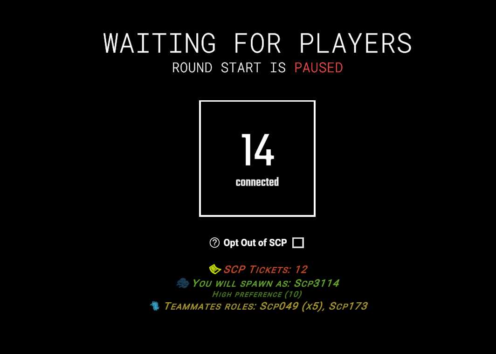
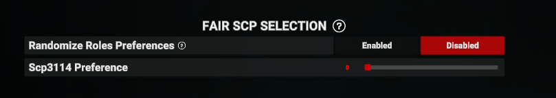
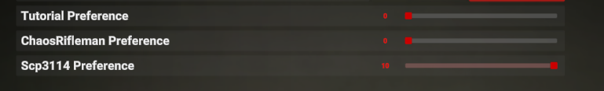

# FairScpSelection
LabAPI plugin that reworks SCP selection system

### Quick note
I am not a native English speaker, so there may be quite a few errors - both logical and spelling-related - in what follows. I appreciate your understanding and would welcome your help in correcting any such mistakes

# Installation

Standard Edition

Put `FairScpSelection.dll` from [releases](https://github.com/CosmosZvezdo4kin/FairScpSelection/releases/latest) in `LabAPI/plugins/...`

Yassa Edition

Put `FairScpSelection.Yassa.dll` from [releases](https://github.com/CosmosZvezdo4kin/FairScpSelection/releases/latest) in `LabAPI/plugins/...`

Put `Yassa.LabApi.dll` version `>= 1.2.0` from [Yassa releases](https://github.com/bladuk/Yassa/releases/latest) or [my releases](https://github.com/CosmosZvezdo4kin/FairScpSelection/releases/latest) in `LabAPI/plugins/...`

Put `0Harmony.dll` version `>= 2.2.0` from [Harmony releases](https://github.com/pardeike/Harmony/releases) or [my releases](https://github.com/CosmosZvezdo4kin/FairScpSelection/releases/latest) (the archive will contain 2 folders; choose the version you need) in `LabAPI/dependencies/...`

> [!WARNING]
> If you encounter an error related to an incorrect version of `Harmony` when attempting to launch a server with multiple plugins, please use any version of `Harmony` that is `2.2.0` or higher - as required by the other plugins

# Resources

<table>
    <tr>
        <td align="center">
            <b>Player Guide</b>  A brief guide on how to correctly configure spawn preferences for regular players
        </td>
        <td align="center">
            <a href="https://github.com/CosmosZvezdo4kin/FairScpSelection/blob/master/.github/docs/player guide/EN.md">  English</a>
        </td>
        <td align="center">
            <a href="https://github.com/CosmosZvezdo4kin/FairScpSelection/blob/master/.github/docs/player guide/RU.md"> Русский</a>
        </td>
    </tr>
    <tr>
        <td align="center">
            <b>Configuration</b>  Config values and their meaning (includes translation and templates)
        </td>
        <td align="center" colspan="2">
            <a href="https://github.com/CosmosZvezdo4kin/FairScpSelection/blob/master/.github/docs/CONFIGURATION.md">  English</a>
        </td>
    </tr>
    <tr>
        <td align="center">
            <b>Commands</b>  Commands, their arguments, and required permissions
        </td>
        <td align="center" colspan="2">
            <a href="https://github.com/CosmosZvezdo4kin/FairScpSelection/blob/master/.github/docs/COMMANDS.md">  English</a>
        </td>
    </tr>
</table>

# Features

## Lobby Interface
It’s easier to show than to explain

[Watch UI demo](https://drive.google.com/file/d/1yMVPQJ1SiICLff5E0fvMC7qOdpKVk5Uh/view?usp=sharing)

## Reserved SCP tickets

This system is designed to protect the "SCP tickets" of players who spawned as SCPs during a round, covering the following scenarios:
1. The round ends prematurely - for instance, due to a mistake by a server administrator or event master.
2. The server crashes or restarts unexpectedly

> [!NOTE]
> When the system is triggered, reserved tickets are automatically issued in the lobby for the next round; players who were selected by the system in the previous round do not need to log in to receive this compensation.

## Yassa Features

> [!WARNING]
> Available only in the <b>Yassa edition</b>

Includes various features related to server-specific settings (a "Randomize Roles Preferences" button and sliders for setting spawn preferences for different roles)

# FAQ

### What is this plugin for ?
To replace the vanilla SCP selection system with a more player-oriented version. Here is a summary of the differences between the vanilla system and the plugin.

| Comparison Subject                    | Vanilla                                                                                                                                                                                                                                                                                                                                     | FairScpSelection                                                                                                                                                                                                                             |
|---------------------------------------|---------------------------------------------------------------------------------------------------------------------------------------------------------------------------------------------------------------------------------------------------------------------------------------------------------------------------------------------|----------------------------------------------------------------------------------------------------------------------------------------------------------------------------------------------------------------------------------------------|
| A chance to become an SCP             | **🎲 Lottery**. Players with the maximum number of tickets are selected at random (`RandomItem`). Others are chosen via weighted randomization. A high ticket balance does not guarantee selection                                                                                                                                          | **⚖️ Priority-based queue**. Strict sorting by number of tickets in descending order. The player with the highest number of tickets is checked first and receives the role, provided it is available                                         |
| Taking spawn preferences into account | **🔻 A secondary factor**. Preferences come into play only after a candidate has been selected. They help in assigning a specific role among those already chosen - provided the preferred role isn’t already taken (which, even then, is a bit of a lottery) - but they do not help one get onto the list of candidates in the first place | **🔺 Initial filter**. In the first iteration, roles are assigned only to those who are highly interested. Tickets are used to rank candidates within this group of "interested" individuals                                                 |
| "Opt Out of SCP" option               | **🚫 Complete exclusion**. The player is removed from the ticket economy: they do not receive 2 tickets if they do not participate in the selection process. However, if there is a shortage of players to take on the role of an SCP, they may still be assigned that role                                                                 | **✅ Soft exclusion**. The player is skipped in the initial selection process but still receives tickets just like everyone else. If there is a shortage of players, they may be called upon as a backup option to ensure the round can take place |
| Ticket distribution                   | **⏱️ Only at the start**. Tickets are awarded exclusively to those present at the moment a round begins. Players who join after a round has started receive nothing                                                                                                                                                                         | **🔄 Guaranteed for everyone**, except for players spawned by the system. It is granted during the round to all active players, including those who join later. Each player receives it once per round                                       |
| Resetting tickets                     | **⚠️ Risk of wasted tickets**. Tickets are consumed as soon as the list of candidates is generated                                                                                                                                                                                                                                          | **🛡️ Safe ticket deduction**. Tickets are only consumed for players who have actually spawned as an SCP. Additionally, there is a safeguard against server crashes in the form of an [SCP ticket reservation system](https://github.com/CosmosZvezdo4kin/FairScpSelection/#reserved-scp-tickets) |
| Transparency                          | **⬛ Black box**. There is no information regarding tickets, odds, or the reasons behind a selection. The player does not understand the system’s logic                                                                                                                                                                                      | **⬜ Full transparency**. The [UI](https://github.com/CosmosZvezdo4kin/FairScpSelection/#lobby-interface) in the lobby shows tickets, your predicted role, your teammates, and the reason for the selection (e.g., "High preference," "Not enough players")                                       |

### What is current development roadmap ?
- [x] Adding an SCP-3114 spawn preference slider for regular gameplay
- [x] Adding "Randomizer" button
- [ ] Adding various features to facilitate the integration of the plugin into third-party systems

### What is SCP overflow system ?
This is a compensation system that was added in version 14.1 of SCP:SL. When the role target number exceeds the maximum limit of SCPs, each SCP will now gain an added `10%` maximum HP and `(5 * missing SCPs count)%` maximum HS bonus. This can be disabled by the `allow_scp_overflow` gameplay config. `allow_scp_overflow: true` = no bonus HP and HS