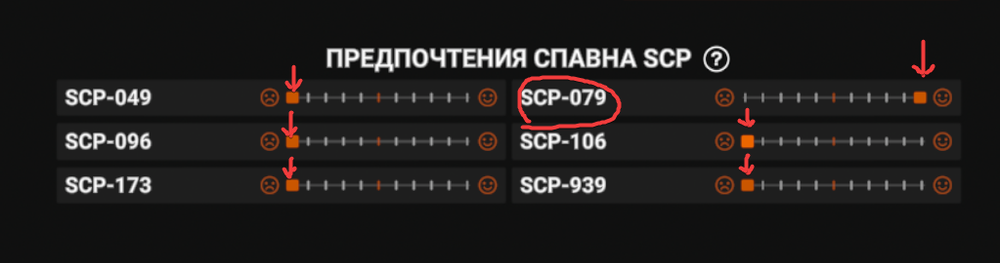
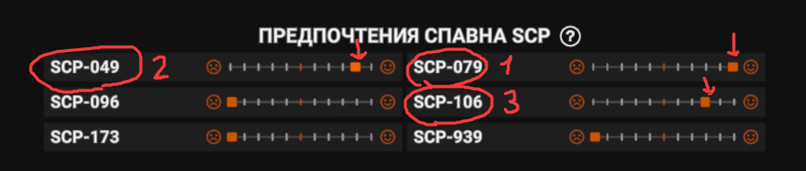
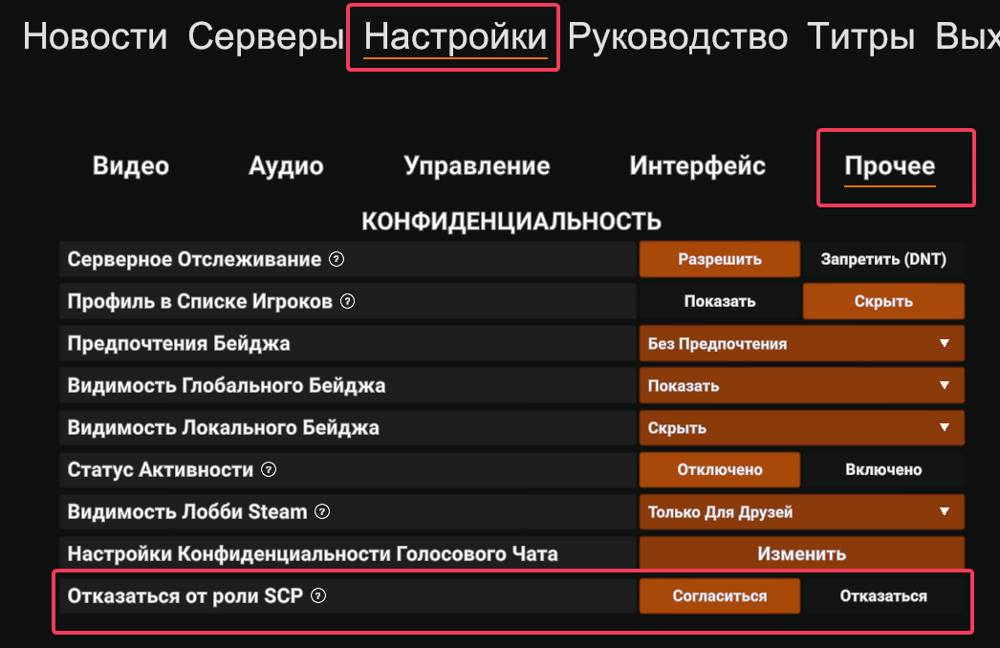
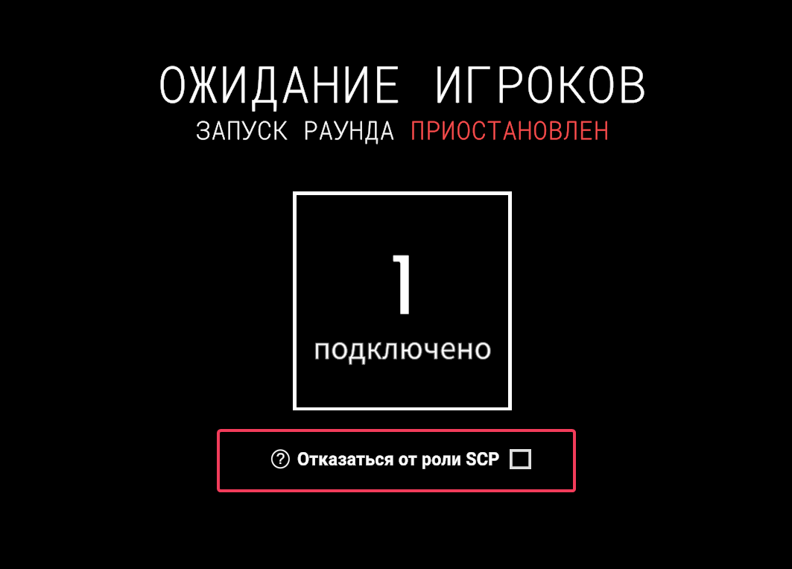

# Гайд для игроков
По названию понятно

## "Я хочу играть только за одного SCP"
В настройках `Прочее` -> `Предпочтения спавна SCP` поставьте своего любимого SCP правее середины, а остальных SCP ставьте левее середины

## "У меня есть несколько любимых SCP"
В настройках `Прочее` -> `Предпочтения спавна SCP` поставьте своих любимых SCP в порядке, где SCP, который находится правее, является более предпочтительным

## "Я не хочу играть за SCP"
В настройках в категории `Прочее` включите опцию `Отказаться от роли SCP` или в лобби ожидания игроков включите опцию `Отказаться от роли SCP`

> [!WARNING]
> Могут быть ситуации, когда сервер не находит нужное количество игроков для спавна за SCP и начинает добирать игроков, опираясь на количество тикетов. В этом случае настоятельно рекомендую расставить все настройки Предпочтения спавна SCP в порядке, где SCP, который находится правее, является более предпочтительным

# FAQ

### Почему я появился за своего нелюбимого SCP ?
Либо ты игрок из категории “А я не читаю новости. Че там случилось?”, либо тебе не повезло и сервер не смог найти подходящее число игроков для спавна за SCP. В любом случае перечитай документ и перепроверь свои настройки `Предпочтения спавна SCP`

> [!WARNING]
> Также это мог админ использовать команду `spawnpreference` на тебе

### Я могу поменять настройки `Предпочтения спавна SCP` до начала раунда уже на сервере ?
Да, можно. Новые настройки Предпочтения спавна SCP сразу отправляются на сервер (таков базовый код игры)

### Какие есть ограничения у появления SCP ?
1. SCP-079 не будет выбран, если нужен только 1 SCP
2. SCP-096 не будет выбран, если нужен только 1 SCP
3. SCP-079 и SCP-096 не будут выбраны вместе, если нужно только 2 SCP

> [!NOTE]
> Эти ограничения работают только если выставлены все значения в конфиге плагина по умолчанию 