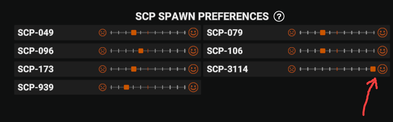
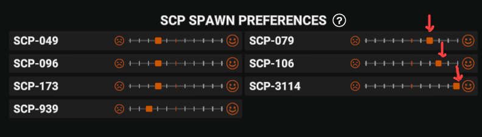

# Player Guide
The name speaks for itself

## "I only want to play as one specific SCP"
In the `Other` -> `SCP Spawn Preferences` setting, place your favorite SCP to the right of the center, and place the other SCPs to the left of the center

## "I have a few favorite SCPs"
In the `Other` -> `SCP Spawn Preferences` setting, arrange your favorite SCPs in an order where an SCP positioned further to the right is more preferred

## "I don't want to play as an SCP"
In the settings, under the `Other` category, enable the `Opt Out of SCP` option, or enable the `Opt Out of SCP` option in the waiting lobby

> [!WARNING]
> There may be situations where the server cannot find enough players to spawn as SCPs and begins selecting additional players based on a ticket system. In such cases, I strongly recommend arranging your "SCP Spawn Preferences" settings so that the SCPs positioned further to the right are the ones you prefer most

# FAQ

### Why did I end up as an SCP that I don't like ?
Either you’re the type of player who says, “I don’t follow the news - what happened?”, or you’ve simply had some bad luck, and the server couldn’t find enough players to fill the SCP spawn slots. In either case, re-read the documentation and double-check your SCP spawn preference settings

> [!WARNING]
> Or it could have been an admin who used the `spawnpreference` command on you

### Can I change the `SCP Spawn Preferences` settings while on the server, before a round begins ?
Yes, that’s possible. New SCP spawn preference settings are sent to the server immediately (that’s how the game’s base code works)

### What are the limitations on the spawn of an SCP ?
1. SCP-079 will not be selected if only 1 SCP is needed
2. SCP-096 will not be selected if only 1 SCP is needed
3. SCP-079 and SCP-096 will not be selected together if only 2 SCPs are needed

> [!NOTE]
> These restrictions only apply when the configuration is set to its default values