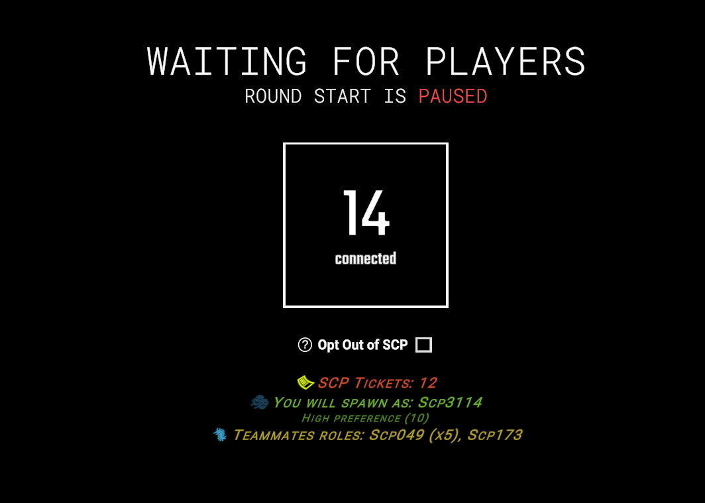

# FairScpSelection

LabAPI plugin that reworks SCP selection system

### Quick note
I am not a native English speaker, so there may be quite a few errors - both logical and spelling-related - in what follows. I appreciate your understanding and would welcome your help in correcting any such mistakes

### TL;DR

[Skip to summary](#what-is-this-plugin-for-)

### Localized player guides

<table>
    <tr>
        <td align="center">
             
            <a href="GUIDE.md">English</a>
        </td>
        <td align="center">
             
            <a href="GUIDE-ru.md">Русский</a>
        </td>
    </tr>
</table>

# Installation

Put plugin dll from [releases](/releases/latest) in `LabAPI/plugins/...`

Put `0Harmony.dll` from [releases](/releases/latest) in `LabAPI/dependencies/...`

# Config and Features

Config file is located at `LabAPI/configs/.../FairScpSelection/config.yml`

| Name                          | Description                                                                                                                                                                                                                                                                                                                                                                                                                                                                                                                                             | Default value                                                                                  |
| ----------------------------- | ------------------------------------------------------------------------------------------------------------------------------------------------------------------------------------------------------------------------------------------------------------------------------------------------------------------------------------------------------------------------------------------------------------------------------------------------------------------------------------------------------------------------------------------------------- | ---------------------------------------------------------------------------------------------- |
| debug                         | Displays hidden logs for debugging                                                                                                                                                                                                                                                                                                                                                                                                                                                                                                                      | false                                                                                          |
| dummy_mode                    | Dummies will be able to participate in the selection of an SCP (to ensure that a dummy's preferences has right values, you must use the `spawnpreference` command on dummy)                                                                                                                                                                                                                                                                                                                                                                           | false                                                                                          |
| include_dummy_in_calculations | Dummies will be included in the player count calculation, which may affect the number of SCPs required to spawn                                                                                                                                                                                                                                                                                                                                                                                                                                         | false                                                                                          |
| tickets_per_round             | The number of SCP tickets granted to a player who is not assigned the role of an SCP or any other role that might be issued by the selection system                                                                                                                                                                                                                                                                                                                                                                                                     | 2                                                                                              |
| min_tickets                   | Minimum number of SCP tickets                                                                                                                                                                                                                                                                                                                                                                                                                                                                                                                           | 10                                                                                             |
| max_tickets                   | Maximum number of SCP tickets                                                                                                                                                                                                                                                                                                                                                                                                                                                                                                                           | 32                                                                                             |
| max_storage_time              | The maximum time (in seconds) to retain data regarding the number of SCP tickets for a specific player in the `ScpTickets.txt file` (in other words, it removes SCP tickets for players who have not logged into the server for a long time). Set the value to `0` if you wish to disable the removal of SCP tickets                                                                                                                                                                                                                                | 1296000                                                                                        |
| lobby_interface               | Lobby Interface Settings                                                                                                                                                                                                                                                                                                                                                                                                                                                                                                                                | [See Here](#lobby-interface)                                                                      |
| reserved_scp_tickets          | SCP ticket reservation system settings                                                                                                                                                                                                                                                                                                                                                                                                                                                                                                                  | [See Here](#reserved-scp-tickets)                                                                 |
| spawn_restrictions            | Role spawn restriction settings                                                                                                                                                                                                                                                                                                                                                                                                                                                                                                                         | [See Here](#spawn-restrictions)                                                                   |
| role_limitations              | Settings for the upper limits on the appearance of specific roles in a round for the SCP selection system. Note that the sum of all values in this configuration has no bearing on the total number of roles the server selects for any given round (that is determined by the number of players on the server and the value set via the `targetrolesnumber` command).   These settings can also be changed using the `rolelimitations` command (the settings will automatically revert to their config file state once the round restarts) | Scp049: 1 Scp079: 1 Scp096: 1 Scp106: 1 Scp173: 1 Scp939: 1 Scp3114: 1 |

> [!NOTE]
> **Ally roles** are roles that have the same Faction

> [!NOTE]
> If `Scp3114` is included in the `role_limitations` config and the `scp3114_halloween_only` config is set to `true`, then `Scp3114` will not be able to spawn outside of the Halloween event.

## Lobby Interface
It’s easier to show than to explain

---

| Name                             | Description                                                                                                                       | Default value |
| -------------------------------- | --------------------------------------------------------------------------------------------------------------------------------- | ------------- |
| is_enabled                       | Enabled or not                                                                                                                    | false         |
| coroutine_delay                  | The delay time in seconds between the start of the cycle that checks SCP selection system data and the sending of hints to player | 1             |
| hint_duration                    | Hint display duration                                                                                                             | 2             |
| show_roles_teammates_whitelist   | Whitelist of roles that can see allies' roles in the hint                                                                         | []            |
| show_team_teammates_whitelist    | Whitelist of teams that can see allies' roles in the hint                                                                         | [ SCPs ]      |
| show_faction_teammates_whitelist | Whitelist of faction that can see allies' roles in the hint                                                                       | []            |

## Reserved SCP tickets

This system is designed to protect the "SCP tickets" of players who spawned as SCPs during a round, covering the following scenarios:
1. The round ends prematurely - for instance, due to a mistake by a server administrator or event master.
2. The server crashes or restarts unexpectedly

| Name               | Description                                                                                                                                                                                                                   | Default value |
| ------------------ | ----------------------------------------------------------------------------------------------------------------------------------------------------------------------------------------------------------------------------- | ------------- |
| is_enabled         | Enabled or not                                                                                                                                                                                                                | true          |
| min_round_duration | The minimum round duration (in seconds) below which the SCP ticket reservation system will be active in the event of an early round end (the reservation system is always active in the event of an accidental round restart) | 60            |

> [!NOTE]
> When the system is triggered, reserved tickets are automatically issued in the lobby for the next round; players who were selected by the system in the previous round do not need to log in to receive this compensation

## Spawn Restrictions

Basic restrictions on the spawning of certain roles (most of these restrictions are taken from the vanilla system)

| Name                       | Description                                                                      | Default value |
| -------------------------- | -------------------------------------------------------------------------------- | ------------- |
| is_enabled                 | Enabled or not                                                                   | true          |
| prevent_non_scp            | Prevents spawn of non-SCP role                                                   | true          |
| prevent_zombies            | Prevents spawn of SCP-0492                                                       | true          |
| prevent_ai_loneliness      | Prevents spawn of SCP-079 if the server requires only 1 SCP                      | true          |
| prevent_shy_guy_loneliness | Prevents spawn of SCP-096 if the server requires only 1 SCP                      | true          |
| prevent_worst_duo          | Prevents spawn of SCP-079 and SCP-096 together if the server requires only 2 SCP | true          |
| scp3114_halloween_only     | Prevents spawn of SCP-3114 outside of a Halloween event                          | true          |

# Translation

Translation file is located at `LabAPI/configs/.../FairScpSelection/translation.yml`

| Name                            | Description                                                                                                                                                                                                                                                              | Default value                                                                                                                                                                                                                                                                                                                                                                                                                                 |
| ------------------------------- | ------------------------------------------------------------------------------------------------------------------------------------------------------------------------------------------------------------------------------------------------------------------------ | --------------------------------------------------------------------------------------------------------------------------------------------------------------------------------------------------------------------------------------------------------------------------------------------------------------------------------------------------------------------------------------------------------------------------------------------- |
| unavailable_role_spawn_reason   |                                                                                                                                                                                                                                                                          | `Unavailable role`                                                                                                                                                                                                                                                                                                                                                                                                                          |
| high_preference_spawn_reason    | {0} is the player's current number of SCP tickets                                                                                                                                                                                                                        | `High preference ({0})`                                                                                                                                                                                                                                                                                                                                                                                                                     |
| not_enough_players_spawn_reason | {0} is the player's current number of SCP tickets                                                                                                                                                                                                                        | `Not enough players ({0})`                                                                                                                                                                                                                                                                                                                                                                                                                  |
| lobby_ui_no_data                |                                                                                                                                                                                                                                                                          | `???`                                                                                                                                                                                                                                                                                                                                                                                                                                       |
| lobby_ui_unavailable_role       |                                                                                                                                                                                                                                                                          | `Mr. Nobody`                                                                                                                                                                                                                                                                                                                                                                                                                                |
| lobby_ui_other_role             |                                                                                                                                                                                                                                                                          | `Human`                                                                                                                                                                                                                                                                                                                                                                                                                                     |
| lobby_ui_hint_text              | `{ScpTickets}` is the player's current number of SCP tickets. `{PredictedRole}` is the player's potential role. `{SpawnReason}` is the reason for this role being selected. `{PredictedTeammates}` is a list of the roles of the player's teammates. | `"<size=0>.</size>          <align=center><size=26><b><i><color=#e6ff00>\U0001F3AB</color> <color=#E05431>SCP Tickets: {ScpTickets}</color> <color=#1c3c52>\U0001F3AD</color> <color=#76bf39>You will spawn as: {PredictedRole} <size=20><color=#588f2b>{SpawnReason}</color></size> <color=#379bbf>\U0001F41B</color> <color=#bfad39>Teammates roles: {PredictedTeammates}</b></i></size></align>"` |

# Commands

List of plugin commands

| Command           | Description                                                                                                                                       | Arguments                                      | Required Permission     |
| ----------------- |---------------------------------------------------------------------------------------------------------------------------------------------------|------------------------------------------------|-------------------------|
| modifytickets     | Change SCP tickets number for player(-s)                                                                                                          | (PlayerId or PlayerId.PlayerId...) (Count)     | `fss.modifytickets`     |
| predictspawnroles | It literally does what it says                                                                                                                    | (Count)                                        | `fss.predictspawnroles` |
| rolelimitations   | Allows you to view (without arguments) or modify the limits on the number of times specific roles can appear in a round                           | (RoleType or RoleType1.RoleType2...)\<Count\>  | `fss.rolelimitations`   |
| sealscptickets    | Allows enabling or disabling the ability to modify tickets via internal systems (excluding commands)                                              |                                                | `fss.sealscptickets`    |
| shufflespawn      | Allows enabling or disabling sorting by players' SCP tickets during role assignment                                                               |                                                | `fss.shufflespawn`      |
| spawnpreference   | Allows you to view (with only one argument) or modify the specific role spawn preference for player or dummy (if[dummy_mode](#config) is `true`)  | (PlayerId)\<RoleType\> \<Count\>               | `fss.spawnpreference`   |
| targetrolesnumber | Allows you to change the number of roles required for a spawn (default is -1)                                                                     | \<Count\>                                      | `fss.targetrolesnumber` |

### Example of usage

* `modifytickets 2.1 32`
* `predictspawnroles 3`
* `rolelimitations Scp049.Scp096.Scp079.Scp106 0`
* `rolelimitations Scp3114 6` 💀

# FAQ

### What is this plugin for ?
To replace the vanilla SCP selection system with a more player-oriented version. Here is a summary of the differences between the vanilla system and the plugin.

| Comparison Subject                    | Vanilla                                                                                                                                                                                                                                                                                                                                 | FairScpSelection                                                                                                                                                                                                                                  |
|---------------------------------------|-----------------------------------------------------------------------------------------------------------------------------------------------------------------------------------------------------------------------------------------------------------------------------------------------------------------------------------------|---------------------------------------------------------------------------------------------------------------------------------------------------------------------------------------------------------------------------------------------------|
| A chance to become an SCP             | **🎲 Lottery**. Players with the maximum number of tickets are selected at random (`RandomItem`). Others are chosen via weighted randomization. A high ticket balance does not guarantee selection                                                                                                                                      | **⚖️ Priority-based queue**. Strict sorting by number of tickets in descending order. The player with the highest number of tickets is checked first and receives the role, provided it is available                                              |
| Taking spawn preferences into account | **🔻 A secondary factor**. Preferences come into play only after a candidate has been selected. They help in assigning a specific role among those already chosen—provided the preferred role isn’t already taken (which, even then, is a bit of a lottery)—but they do not help one get onto the list of candidates in the first place | **🔺 Initial filter**. In the first iteration, roles are assigned only to those who are highly interested (+5). Tickets are used to rank candidates within this group of "interested" individuals                                                 |
| "Opt Out of SCP" option               | **🚫 Complete exclusion**. The player is removed from the ticket economy: they do not receive 2 tickets if they do not participate in the selection process. However, if there is a shortage of players to take on the role of an SCP, they may still be assigned that role                                                             | **✅ Soft exclusion**. The player is skipped in the initial selection process but still receives tickets just like everyone else. If there is a shortage of players, they may be called upon as a backup option to ensure the round can take place |
| Ticket distribution                   | **⏱️ Only at the start**. Tickets are awarded exclusively to those present at the moment a round begins. Players who join after a round has started receive nothing                                                                                                                                                                     | **🔄 Guaranteed for everyone**, except for players spawned by the system. It is granted during the round to all active players, including those who join later. Each player receives it once per round                                            |
| Resetting tickets                     | **⚠️ Risk of wasted tickets**. Tickets are consumed as soon as the list of candidates is generated                                                                                                                                                                                                                                      | **🛡️ Safe ticket deduction**. Tickets are only consumed for players who have actually spawned as an SCP. Additionally, there is a safeguard against server crashes in the form of an [SCP ticket reservation system](#reserved-scp-tickets)      |
| Transparency                          | **⬛ Black box**. There is no information regarding tickets, odds, or the reasons behind a selection. The player does not understand the system’s logic                                                                                                                                                                                  | **⬜ Full transparency**. You can enable the [UI display](#lobby-interface) via the config file. The UI in the lobby shows tickets, your predicted role, your teammates, and the reason for the selection (e.g., "High preference," "Not enough players")          |

### What is current development roadmap ?
- [ ] Adding an SCP-3114 spawn preference slider for non-Halloween gameplay
- [ ] Adding various features to facilitate the integration of the plugin into third-party systems